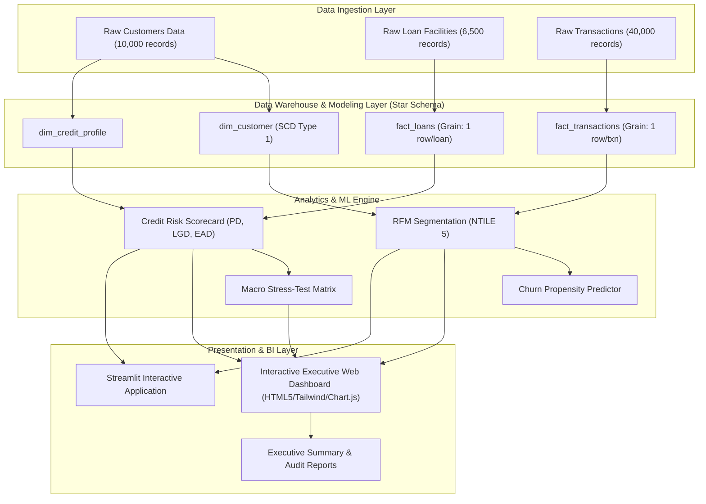
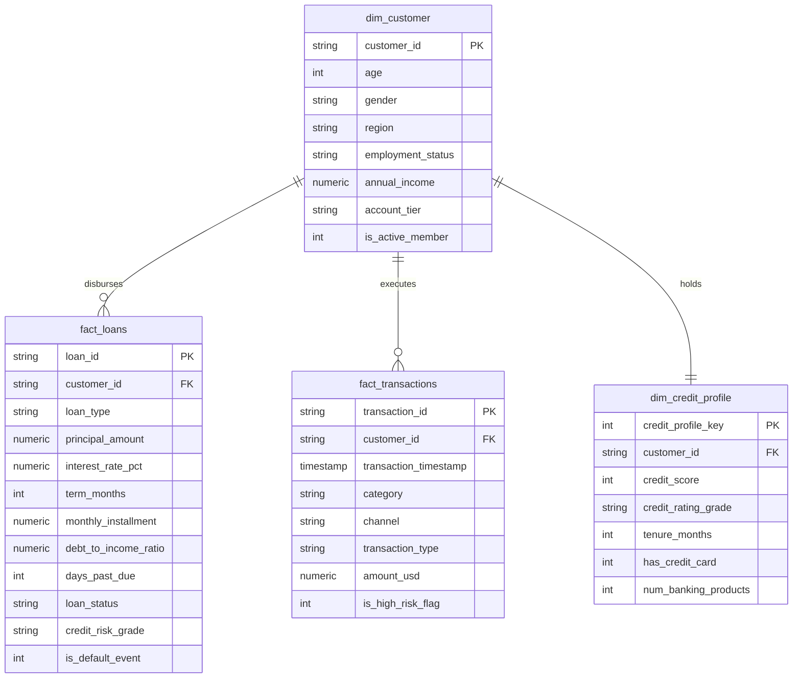

# FinVanguard 360° | System & Data Architecture

## 1. High-Level Data Flow

---

## 2. Star Schema Entity-Relationship (ER) Diagram

---

## 3. Financial Mathematical Models Implemented

### 1. Net Interest Margin (NIM)
$$\text{NIM} = \frac{\text{Investment Returns / Loan Interest} - \text{Deposit Interest Paid}}{\text{Average Earning Assets}}$$

### 2. Basel II Expected Loss ($EL$)
$$\text{EL} = \text{PD} \times \text{LGD} \times \text{EAD}$$
* **$\text{PD}$ (Probability of Default)**: Estimated through calibrated logistic scoring based on FICO, DTI, and facility collateral.
* **$\text{LGD}$ (Loss Given Default)**: $20\%$ for residential mortgages; $50\%$ for unsecured facilities.
* **$\text{EAD}$ (Exposure at Default)**: Outstanding principal facility balance.

### 3. Credit Model Discrimination Metrics
* **ROC-AUC**: Evaluates ranking capability between non-delinquent and defaulted accounts.
* **Gini Coefficient**:
  $$\text{Gini} = 2 \times \text{AUC} - 1$$
* **Kolmogorov-Smirnov (KS) Statistic**:
  $$\text{KS} = \max_t |F_{\text{good}}(t) - F_{\text{bad}}(t)|$$
